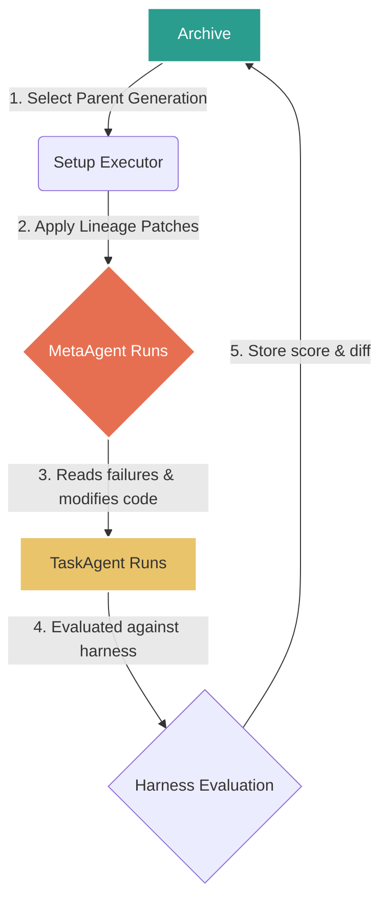

# Basic Concepts

HyperFlow is a self-improving agent framework. Instead of manually tuning an AI agent, you let another AI agent do it automatically.

The core idea comes from **evolutionary computation** algorithms, which are optimization methods inspired by biological evolution. Instead of having a single AI agent try to optimize its logic once, the system maintains a "population" (or archive) of different agent versions. Over multiple generations, the system "selects" the best performing agents, applies "mutations" (having the MetaAgent rewrite their code to fix errors), and generates new offspring agents. Over time, the agents naturally evolve to achieve higher success rates on tasks without human intervention.

## The Two Agents

### TaskAgent — The Worker

The TaskAgent serves as the problem solver for domain-specific tasks. It receives a formatted prompt, optionally uses tools, and returns a prediction.
- **Input**: A task description.
- **Output**: A prediction.
- **Tools**: Domain-specific, optional.

### MetaAgent — The Improver

The MetaAgent's job is to make the TaskAgent better. It acts as the "mutation operator". It reads past evaluation results, identifies failures, and refines the TaskAgent's **prompts, logic, and tools** to fix them.
- **Input**: Repo path + eval results path + parent score
- **Output**: Modified source code on disk (patches/diffs)
- **Tools**: `bash` (run shell commands) + `editor` (view/edit files) — built-in

## The Evolutionary Loop

The evolutionary loop (`run_generate_loop`) is the heart of the system. It runs multiple generations, each improving on a previous one.

## The Archive

The archive is the central data structure stored as a JSON Lines (JSONL) file that records the history of all generations. It serves as a **versioned record of evolutionary improvement**, acting as a family tree where different generations can branch from different original parent versions.
